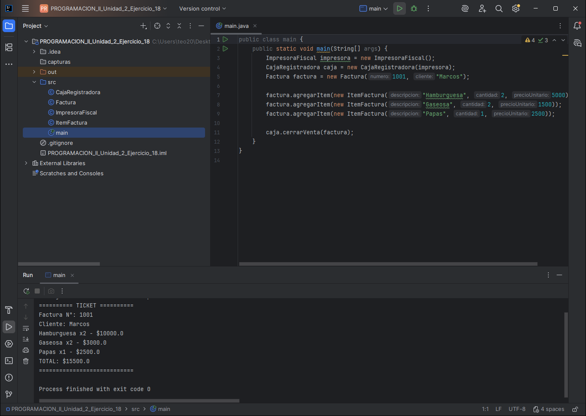

# PROGRAMACIÓN II — Unidad 2, Ejercicio 18: El Sistema de Facturación y Emisión de Tickets

Trabajo práctico de Programación II. Este repositorio contiene la resolución en Java del ejercicio 18 de la Unidad 2.

## Consigna

#### Contexto

Al finalizar una comida en un restaurante, el sistema de caja genera una factura detallada. Para lograrlo, el objeto Caja se comunica con un objeto ImpresoraFiscal enviándole el objeto factura completo para que este último proceda con su formato e impresión física.

#### Consigna

Modelar la colaboración entre la lógica de negocio de cobro y el subsistema de periféricos mediante el envío de mensajes que transporten documentos complejos en Java.

#### Desarrollo requerido

- Definir las clases ItemFactura (con descripción, cantidad y precio unitario) y Factura (con número, cliente y lista de ítems).
- Crear la clase ImpresoraFiscal con un método imprimirDocumento(Factura factura) que simule el formateo y despliegue del ticket.
- Desarrollar la clase CajaRegistradora que posea una referencia a la impresora y un método cerrarVenta(Factura factura) que dispare la comunicación.
- En el método main, instanciar una caja, una impresora, armar una factura con varios ítems y ejecutar la orden de impresión mostrando el formato resultante en la consola.

## Estructura del repositorio

```
PROGRAMACION_II_Unidad_2_Ejercicio_18/
├── README.md
├── capturas/
│   └── consola.png
└── src/
    ├── CajaRegistradora.java
    ├── Factura.java
    ├── ImpresoraFiscal.java
    ├── ItemFactura.java
    └── main.java   # clase con el método main
```

## Funcionamiento y lógica

El ejercicio simula el cierre de una venta: la caja registradora le envía la factura a la impresora fiscal, que imprime el ticket.

### `ItemFactura`

Representa un renglón de la factura con `descripcion`, `cantidad` y `precioUnitario`. Su método `calcularSubtotal()` devuelve cantidad × precio.

### `Factura`

Tiene `numero`, `cliente` y una lista (`ArrayList`) de ítems.

- **`agregarItem()`:** suma un ítem a la factura.
- **`calcularTotal()`:** recorre los ítems y suma sus subtotales.

### `ImpresoraFiscal`

Su método `imprimirDocumento(Factura)` arma el ticket: número, cliente, cada ítem con su cantidad y subtotal, y el total.

### `CajaRegistradora`

Recibe la impresora en el constructor. Su método `cerrarVenta(factura)` le envía la factura a la impresora para que la imprima.

### `main`

Crea la impresora, la caja y la factura **1001** para Marcos con 2 hamburguesas ($10000), 2 gaseosas ($3000) y 1 papas ($2500). Al cerrar la venta se imprime el ticket con un total de **$15500**.

## Ejecución

Captura de la consola de IntelliJ IDEA ejecutando el programa:



Salida obtenida:

```
La caja envía la factura a la impresora.
========== TICKET ==========
Factura N°: 1001
Cliente: Marcos
Hamburguesa x2 - $10000.0
Gaseosa x2 - $3000.0
Papas x1 - $2500.0
TOTAL: $15500.0
============================
```
